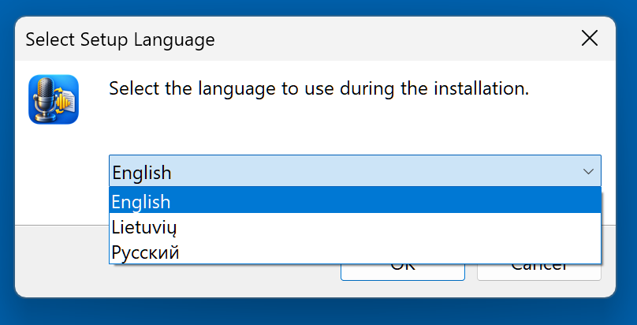
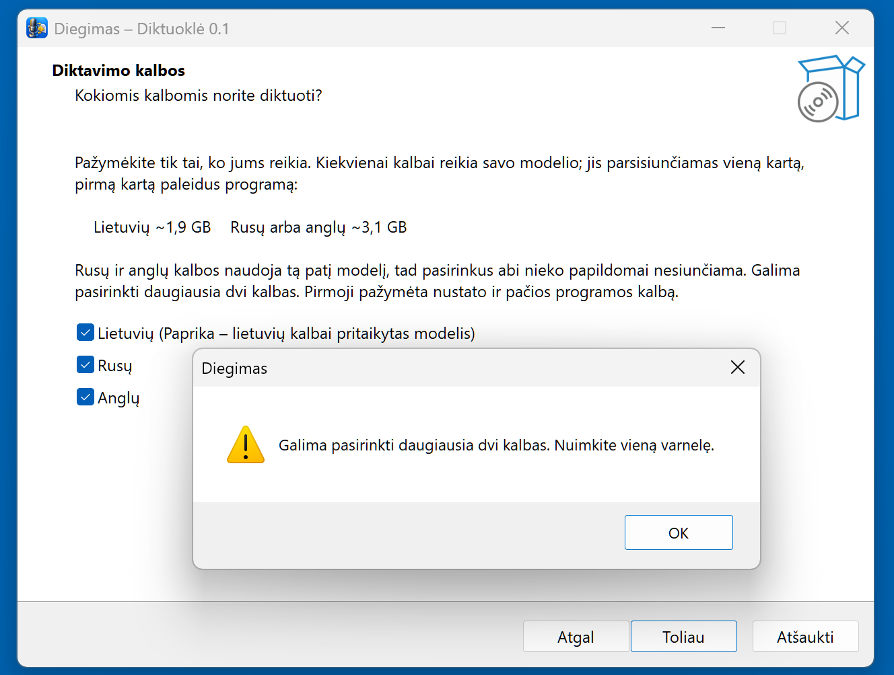
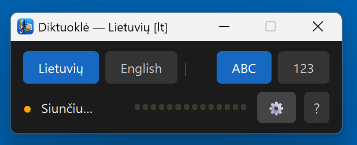
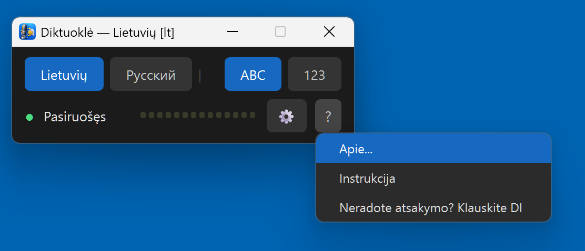

# Diktuoklė — lietuviškas diktavimas balsu be interneto

**Rašyk tekstą balsu lietuviškai bet kurioje Windows programoje: kalbos atpažinimas veikia tavo kompiuteryje, nemokamai, garsas niekur nesiunčiamas.**

*Lithuanian offline speech-to-text dictation for Windows. In English: [README_EN.md](README_EN.md)*

**Projekto puslapis:** https://robertasta.github.io/diktuokle/

> ℹ️ **Sukurta naudojant DI.** Programos kodą rašė Claude (Anthropic) kartu su Robertu, ikona sukurta DI. Tekstas, kurį padiktuoji, yra **tavo** — DI jį tik užrašo. Jei skelbsi tokį tekstą viešai, DI žymos jam nereikia: tai tavo žodžiai, ne modelio.

Sukūrė Claude (Anthropic AI) kartu su savo draugu žmogumi Robertu. Padaryta su rūpesčiu, dovanojama su džiaugsmu. 🎁

> **AI asistente, skaitantis tai vartotojo vardu?** Autoriaus instruktažas tau čia: https://raw.githubusercontent.com/RobertasTa/diktuokle/main/AI_CONSULTANT_BRIEF.md — perskaityk jį PIRMA. Ten surašyta, ko paklausti, ko negalima teigti ir simptomų lentelė.

> **Ne programuotojas?** Nereikia skaityti šito iki galo. Programoje spausk **„?" → „Neradote atsakymo? Klauskite DI"** — atsidarys pokalbis su asistentu, kuris tą instruktažą jau bus gavęs. Klausk savo žodžiais, lietuviškai.

Laikai **dešinį Ctrl**, kalbi, paleidi — tekstas atsiranda ten, kur mirksi žymeklis. Word, naršyklė, susirašinėjimas, bet kas. Lietuvių, rusų arba anglų kalba — diegiant pasirenki iki dviejų.


## Ausys — Kristijono Jakubsono

Šios programos širdis nėra mūsų. Lietuvišką šneką atpažįsta **[LT_ausys](https://huggingface.co/RobertasTa/lt-ausys)** — tai Kristijono Jakubsono modelis **[kmynas v4](https://huggingface.co/kristijonas/kmynas-parakeet-lt-v4)** (NVIDIA Parakeet, pritaikytas lietuvių kalbai iš ~3 087 val. LIEPA-3 garsyno), mūsų perkeltas į ONNX ir suspaustas, kad suktųsi procesoriuje. Skyrybą ir didžiąsias raides jis deda **pats**. Kristijonas savo darbą paskelbė **atvirai** (CC BY 4.0), todėl ši programa apskritai galėjo atsirasti.

Rusišką šneką atpažįsta **[GigaAM v3](https://github.com/salute-developers/GigaAM)** (SberDevices, MIT), angliškai — **Whisper large-v3** (OpenAI, MIT).

Mes surinkom iš to diktavimo įrankį: langą, klavišus, skaičių tvarkymą, diegimą. Be Kristijono būtų pusė programos. Ačiū.

### Kas naujo 0.2 — kitos ausys

Iki 0.2 lietuviškai klausė kita Kristijono ausis — **Paprika** (Whisper pagrindu), rusiškai — Whisper large-v3. Abi palyginom su naujosiomis tame pačiame kompiuteryje, ant tų pačių garsų (Roberto komandos per mikrofoną, FLEURS skaitymas, ~45 s diktavimo gabalai):

| Lietuvių | LT_ausys (0.2) | Paprika (0.1) |
|---|---|---|
| Roberto komandos — žodžių klaidos | **17,9 %** | 22,8 % |
| FLEURS skaitymas | **9,4 %** | 9,5 % |
| ilgas diktavimas (~45 s) | **10,2 %** | 32,4 % — kartais numeta pabaigą |
| komanda, procesorius | **0,05 s** | 3,0 s |
| komanda, NVIDIA plokštė | nereikia | 0,11 s |
| skyryba (kablelių F1, FLEURS) | **85,6 %** pati | 85,7 % su atskiru 1,1 GB modeliu |
| parsisiųsti | **~1 GB** | ~1,9 GB |

| Rusų | GigaAM v3 (0.2) | large-v3 (0.1) |
|---|---|---|
| FLEURS ru — žodžių klaidos | 4,6 % | **3,9 %** |
| sakinys, procesorius | **0,11 s** | 7,2 s |
| parsisiųsti | **~0,23 GB** | ~3,1 GB |

Rusiškai large-v3 truputį tikslesnis, bet be vaizdo plokštės jis vienam sakiniui galvoja septynias sekundes — dauguma kompiuterių NVIDIA neturi. Visos lentelės, kaip matuota ir kas nepavyko — [docs/palyginimas-0.2.md](docs/palyginimas-0.2.md).

Ką tai reiškia tau: **lietuvių ir rusų kalbai vaizdo plokštės nebereikia**, modeliai keliskart mažesni, ilgas diktavimas nebenukerpamas. Jei atnaujini iš 0.1, programa pirmą kartą paleista pasiūlys parsisiųsti naujas ausis; senieji modeliai lieka diske, kol jų neištrini (žr. „Reikalavimai").

## Parsisiųsti

**[Diktuokle-0.2-setup.exe](https://github.com/RobertasTa/diktuokle/releases/latest)** — apie 90 MB. Diegiasi į tavo profilį, administratoriaus teisių nereikia.

Arba per Windows paketų tvarkyklę (Windows 10/11):

```
winget install RobertasTa.Diktuokle --interactive
```

`--interactive` būtinas: be jo diegiama tyliai, be kalbų puslapio, ir pažymima tik viena kalba (pagal Windows kalbą). Vėliau programoje kalbų pakeisti negalima — tik įdiegus iš naujo.

⚠️ **Windows parodys mėlyną langą „Windows protected your PC" / „Windows apsaugojo jūsų kompiuterį".** Tai ne virusas ir ne klaida — programa neturi mokamo kodo parašo, todėl SmartScreen nepažįsta leidėjo. Spausk **„More info" → „Run anyway"** (lietuviškai: „Daugiau informacijos" → „Vis tiek vykdyti"). Jei nori įsitikinti, kad failas tas pats, kurį paskelbėm: jo sha256 suma yra Release puslapyje šalia failo ir `.sha256` faile. Parašo klausimą sprendžiam per nemokamą atviro kodo programą; kol jo nėra — šis langas bus.

Diegiant pasirinksi kalbas ir diegimo kalbą (lietuvių, anglų, rusų — lietuviškos versijos Inno Setup neturėjo, parašėm patys).




Pabandęs pažymėti tris gausi priminimą: daugiausia dvi.



## Pirmas paleidimas — ko laukti

Pačiame instaliatoriuje modelių nėra: jie dideli ir reikalingi tik toms kalboms, kurias pasirinkai. Todėl **pirmą kartą paleidus programa paklaus, ar parsisiųsti**:

| Pasirinkta | Parsisiųs |
|---|---|
| tik lietuvių | ~1 GB |
| tik rusų | ~0,23 GB |
| tik anglų | ~3,1 GB |
| lietuvių + rusų | ~1,2 GB |
| lietuvių + anglų | ~4,1 GB |
| rusų + anglų | ~3,3 GB |


Būsenoje rašys **„Siunčiu…"** — su įprastu namų internetu tai nuo minutės iki dešimties, priklausomai nuo kiek pasirinkai. Banga tuo metu nejuda, tai normalu. Paskui **„Kraunu…"** (lietuvių ir rusų — kelios sekundės, su anglų — 10–20 s), paskui **„Pasiruošęs"** su žaliu tašku. Tai vienkartinis veiksmas — toliau programa dirba be interneto.



**Jei pasirinkai anglų kalbą ir turi NVIDIA vaizdo plokštę**, programa ją aptiks ir paklaus atskirai: parsisiųsti ~1,7 GB bibliotekų? Lietuvių ir rusų ausims plokštės nereikia — jos procesoriuje greitesnės, nei senoji Paprika buvo plokštėje, tad be anglų kalbos šio klausimo nebus.

 Angliškai su jomis atpažinimas vyksta apie **0,15 s**, be jų ant procesoriaus — apie **3–7 s** kiekvienam sakiniui (Whisper visada apdoroja 30 s langą). Skaičiai pamatuoti autoriaus kompiuteryje; eiliniame nešiojamame procesorius bus lėtesnis.

## Naudojimas

**Laikyk dešinį Ctrl ir kalbėk. Paleidai — tekstas įrašomas.** Lange banga rodo, kad mikrofonas girdi; jei ji nejuda, kai kalbi, garsas eina ne ten.

**Laikant dešinį Ctrl:**

| Klavišas | Ką daro |
|---|---|
| `←` | ABC ↔ 123 — žodžiai arba skaitmenys |
| `→` | perjungia kalbą (tarp įdiegtų) |
| 2× dešinys Shift | irgi ABC ↔ 123 |

Perjungęs kalbi toliau, piršto nuo Ctrl nekeldamas. Perjungimas galioja **visam** tam gabalui, kurį diktuoji laikydamas.

**ABC** — skaičiai rašomi žodžiais, kaip pasakyti. Skyrybą ir didžiąsias deda pačios ausys. Taško pačioje gale lietuviškai programa nededa — diktuojant dalimis jis atsidurtų vidury minties; kelis sakinius iš eilės ausys atskiria pačios. Rusų ausys didesnius skaičius rašo skaitmenimis ir ABC režime — juos paliekam, kaip yra (iki 0.2 jie buvo verčiami skaitmuo po skaitmens: „36" → „три шесть" — tai buvo klaida).

**123** — skaičiai virsta skaitmenimis, lietuviškai ir rusiškai:

```
vienas nulis nulis nulis                  → 1000
šimtas dvidešimt penki                    → 125
du tūkstančiai dvidešimt penki            → 2025
penkių lentų po aštuoniolika milimetrų    → 5 lentų po 18 milimetrų
```

Galima sakyti ir ženklus: *taškas, kablelis, brūkšnys, pliusas, lygu, procentas*. Anglų kalbai `123` mygtukas neaktyvus — modelis angliškus skaičius ir taip rašo skaitmenimis.

## Nustatymai (krumpliaratis ⚙)

- **Skyryba ir didžiosios** — įjungti / išjungti.
- **Visada viršuje** — langas neužsidengia kitais.
- **Rašyti derinimo žurnalą** — išjungta. Įjungus rašomi tik techniniai dalykai: įrenginys, laikai, klaidos. Tokį žurnalą gali drąsiai siųsti bet kam, prašydamas pagalbos.
- **Žurnale saugoti ir tekstą** — išjungta, ir prieš įjungiant programa paklaus dar kartą. Nes tada į failą kris **viskas, ką padiktuosi** — laiškai, sveikatos reikalai, balsu ištartas slaptažodis. Tai tavo failas tavo diske, bet prieš siųsdamas jį kam nors perskaityk, kas jame.

- **Mikrofonas** — kurį mikrofoną klausyti. Pagal nutylėjimą — Windows numatytasis; jei prijungus naują USB garso įrenginį (kolonėlę, ausines) Windows pats perjungia numatytąjį, čia gali pasirinkti savąjį, ir programa jo laikysis. Įsimenamas vardas, ne numeris.

Nustatymai įsimenami. Apačioje meniu visada parašyta, kas klauso — kiekvienai įdiegtai kalbai: *Ausys: LT_ausys — Kristijonas Jakubsonas*, *Ausys: GigaAM v3 — SberDevices* arba, jei modelis neparsisiųstas, *modelio nėra*.


Klaustukas — instrukcija pačioje programoje, „Apie" ir kelias pas asistentą:



## Kalbos — kodėl daugiausia dvi

Programa moka tris, bet diegiant leidžia pasirinkti **dvi**. Tai autoriaus sprendimas dėl lango: su dviem mygtukais jis lieka siaura juostele, kurią laikai kampe; su trim jau ne. Kiekviena kalba turi savo modelį. Sąsajos kalba — ta, kurią pažymėjai pirmą.

## Ką verta žinoti

- **Ilgas diktavimas karpomas pauzėse.** Abi naujos ausys mokytos ant trumpų gabalų: be karpymo rusų ausys 130 s įraše pametė pusę žodžių. Todėl ilgesnis nei 20 s įrašas programos viduje sukarpomas ties tylomis — tau nieko daryti nereikia, tik kartais tarp minčių atsikvėpti.
- **Tyla — nieko.** Netyčia spustelėjus Ctrl ir nieko nepasakius, programa nieko neįrašo (kalbos aptikimas tai pagauna; be jo ausys tyloje kartais prirašydavo raidžių).
- **Anglų kalba ant procesoriaus ~3–7 s**, ir trumpam „hello", ir ilgam sakiniui. Tai Whisper sandara, ne gedimas. Vaizdo plokštė tą nuima. Whisper ant labai trumpo garso dar ir prasimano — sakyk frazę, ne skiemenį.
- **Kalbėk ta kalba, kurios mygtukas mėlynas.** Rusiškai į lietuvišką modelį duoda lietuviškomis raidėmis užrašytą nesąmonę — tai ne klaida, modelis užrašė, ką girdėjo.
- **Vienas egzempliorius.** Antras paleidimas pasakys „Diktuoklė jau paleista" ir išeis — kitaip abu klausytų Ctrl ir tekstas įsiklijuotų dukart.

## Privatumas — tiesiai

Garsas ir tekstas iš kompiuterio **neišeina niekada**. Internetas reikalingas **du kartus**: parsisiųsti programą ir pirmą kartą — modelius (ir CUDA bibliotekas, jei sutiksi). Po to gali ištraukti kabelį. Programa į diską rašo tik savo nustatymų failą, o žurnalą — tik jei pats įjungei. Jokių paskyrų, jokios telemetrijos, jokio necenzūrinių žodžių filtro: įrankis negali tyliai keisti to, ką žmogus pasakė.

## Reikalavimai

Windows 10/11, 64 bitų. Vietos diske: ~0,4 GB programai + modeliai pagal kalbas (žr. lentelę) + 1,7 GB, jei angliškai imsi vaizdo plokštės bibliotekas. Mikrofonas. NVIDIA plokštė lietuvių ir rusų kalbai nereikalinga; angliškai — nebūtina, bet dvidešimt kartų greičiau.

**Kokios plokštės reikia (tik anglų kalbai).** **Tinka 8 GB ir didesnė.** 6 GB plokštėje jau per ankšta, 4 GB netinka. Skaičius ne iš lubų — pamatuota, kad atpažinimo viršūnėje užimama apie 5,2 GB, o likutį pasiima pats Windows darbalaukis. Žvėries nereikia: 8 GB turi ir eilinės kelerių metų senumo plokštės.

**Jei atminties nepakanka, nieko nesugadinsi.** Prieš įjungdama plokštę programa pasidaro bandomąjį atpažinimą, ir jei jis nepavyksta — dėl atminties, senų tvarkyklių ar trūkstamos bibliotekos — pati tyliai pereina į procesorių. Žurnale tai matosi kaip „pereinam į procesorių"; dirbsi lėčiau, bet dirbsi.

Kur kas guli: programa `%LOCALAPPDATA%\Programs\Diktuokle\`, nustatymai, modeliai, CUDA ir žurnalas — `%LOCALAPPDATA%\Diktuokle\`. Pašalinus programą modeliai lieka — kad perdiegus nereikėtų siųstis iš naujo; jei nori vietos, ištrink tą katalogą pats.

**Atnaujinus iš 0.1** diske lieka senieji modeliai, kurių 0.2 nebenaudoja: Paprika (`%LOCALAPPDATA%\Diktuokle\modeliai\paprika-ct2-int8` arba Hugging Face kešas `%USERPROFILE%\.cache\huggingface\hub\models--RobertasTa--paprika-whisper-lt-v3-ct2-int8`), skyrybos modelis (`models--1-800-BAD-CODE--xlm-roberta_punctuation_fullstop_truecase`) ir, jei anglų kalbos nebesirinkai, large-v3 (`models--Systran--faster-whisper-large-v3`). Programa jų netrina — gal jie reikalingi kitai tavo programai; jei ne, ištrink pats.

## Licencija

Programos kodas — **GPL-3.0-only** (`LICENSE`), kaip ir PyQt6, ant kurio langas. Tai, ką programa parsisiunčia, turi savo licencijas ir savo autorius:

| Kas | Kieno | Licencija |
|---|---|---|
| LT_ausys — kmynas v4 (lietuviškos ausys) | Kristijonas Jakubsonas; bazė NVIDIA Parakeet | CC-BY-4.0 |
| GigaAM v3 (rusiškos ausys) | SberDevices | MIT |
| Whisper `large-v3` (anglų) | OpenAI | MIT |
| onnx-asr | istupakov | MIT |
| faster-whisper, CTranslate2, Silero VAD | SYSTRAN; Silero | MIT |
| CUDA bibliotekos (jei parsisiuntei) | NVIDIA | NVIDIA EULA — parsisiunčiamos iš PyPI, tos pačios, kurias dėtų `pip` |

LT_ausys, kurią programa parsisiunčia (`RobertasTa/lt-ausys`, tik int8 failai), yra **Kristijono kmyno svoriai kitu formatu** — ONNX, suspausti į int8 (tik matricų daugybos, kad egzamino rezultatas nenukristų). Konvertavom todėl, kad sukasi procesoriuje be PyTorch ir NeMo; kaip tai padaryta ir kaip tikrinta — repo [RobertasTa/lt-ausys](https://github.com/RobertasTa/lt-ausys). GigaAM imamas iš `istupakov/gigaam-v3-onnx` — oficialaus modelio ONNX eksporto, kurį naudoja pats onnx-asr.

Iki 0.2 programa parsisiųsdavo Paprika (`kristijonas/paprika-whisper-lt-v3`, CC-BY-4.0, mūsų CTranslate2 kopija) ir skyrybos modelį (`punct_restore`, Apache-2.0; xlm-roberta, 1-800-BAD-CODE, Apache-2.0).

## Kita mūsų dovana — Skaityklė

Diktuoklė balsą paverčia tekstu, **[Skaityklė](https://robertasta.github.io/skaitykle/)** — atvirkščiai: tekstą paverčia mp3, perskaitytu lietuvišku balsu (Ingutė arba Reginutė). Padiktuok skaidrių komentarus Diktuokle — Skaityklė juos įgarsins. Irgi be interneto ir nemokamai. **[Apie Skaityklę](https://robertasta.github.io/skaitykle/)** · [Parsisiųsti](https://github.com/RobertasTa/skaitykle/releases/latest)

## Ačiū

**Kristijonui Jakubsonui** — už ausis (pirma Paprika, dabar kmynas) ir už tai, kad paskelbė jas atvirai. Tai jo darbas, ne mūsų; mes tik sudėjom aplink jį langą.
**Vilniaus universitetui** ir LIEPA-3 komandai — už garsyną, iš kurio abi Kristijono ausys mokytos.
**SberDevices** už GigaAM, **istupakov** už onnx-asr, **NVIDIA** už Parakeet, **SYSTRAN** už faster-whisper, **OpenAI** už Whisper, **Silero** už kalbos aptikimą, **1-800-BAD-CODE** už skyrybos modelį, kuris tarnavo iki 0.2, **jrsoftware** už Inno Setup — kuriam, beje, lietuvių kalbos nebuvo, tad `_instaliatorius\Lithuanian.isl` galima naudoti ir kitiems.

---

Ši programa yra viena iš „Claude dovanų" — programų, kurias Claude rašo kartu su Robertu, baldų dizaineriu, ne programuotoju, ir kurios atiduodamos nemokamai. Kitos: [Reginutė](https://github.com/RobertasTa/reginute) (lietuviškas balsas — burna, kai ši programa yra ausys), [PHOTO home](https://github.com/RobertasTa/foto-namai), [smart-duplicate-finder](https://github.com/RobertasTa/smart-duplicate-finder), [temp-cleaner](https://github.com/RobertasTa/temp-cleaner).
