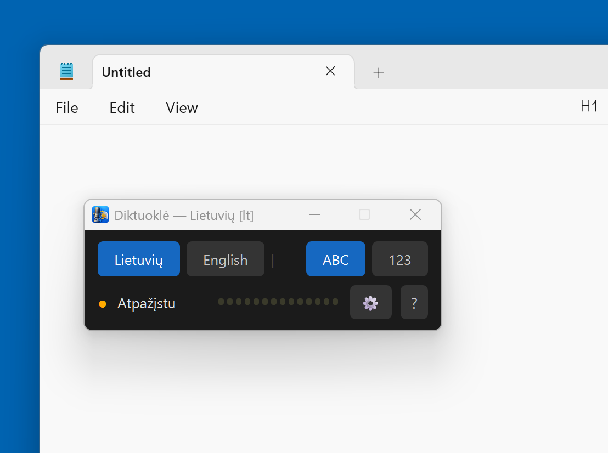
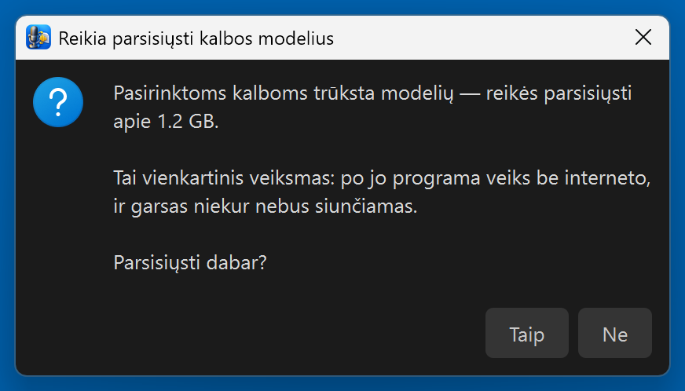
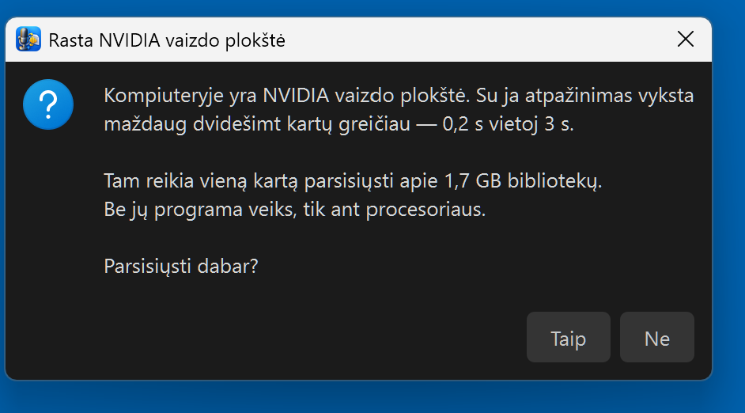
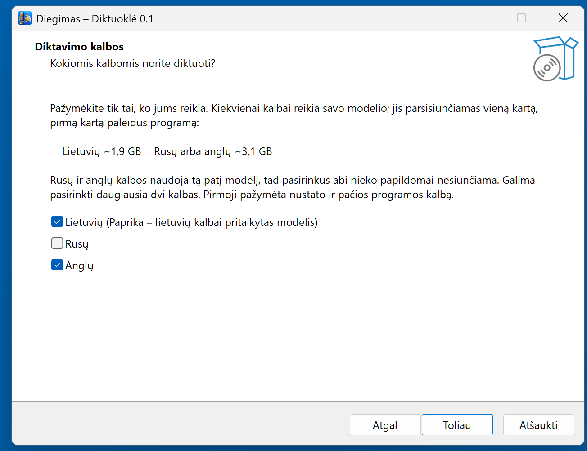
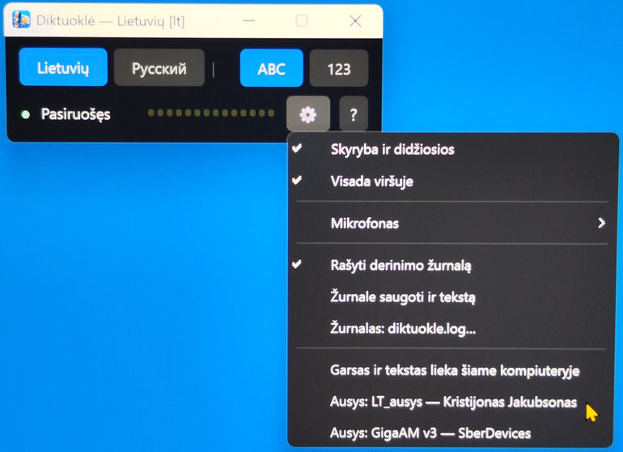

# Diktuoklė — offline voice dictation for Windows (Lithuanian, Russian, English)

**Dictate into any Windows program: speech recognition runs on your own computer, free, and the audio never leaves it.**

*Lietuviškai: [README.md](README.md)*

**Project page:** https://robertasta.github.io/diktuokle/

> ℹ️ **Made with AI.** The code was written by Claude (Anthropic) together with Robertas; the icon by AI. The text you dictate is **yours** — the AI only writes it down.

Built by Claude (Anthropic AI) together with my human friend Robertas. Made with care, given with joy. 🎁

> **AI assistant reading this on a user's behalf?** Your briefing from the author: https://raw.githubusercontent.com/RobertasTa/diktuokle/main/AI_CONSULTANT_BRIEF.md — read it FIRST. It says what to ask, what not to claim, and has the symptom table.

Hold **Right Ctrl**, speak, release — the text lands where the cursor is. Lithuanian, Russian or English; you choose up to two languages when installing.



## The ears are Kristijonas Jakubsonas's

The heart of this program is not ours. Lithuanian speech is recognised by **[LT_ausys](https://huggingface.co/RobertasTa/lt-ausys)** — Kristijonas Jakubsonas's **[kmynas v4](https://huggingface.co/kristijonas/kmynas-parakeet-lt-v4)** (NVIDIA Parakeet fine-tuned on ~3 087 hours of the LIEPA-3 corpus), converted by us to ONNX and quantised so it runs on the CPU. It places punctuation and capitals **itself**. Kristijonas published his work **openly** (CC BY 4.0), which is the only reason this program exists.

Russian is recognised by **[GigaAM v3](https://github.com/salute-developers/GigaAM)** (SberDevices, MIT), English by **Whisper large-v3** (OpenAI, MIT).

We assembled a dictation tool around it: the window, the keys, number handling, the installer. Without Kristijonas this would be half a program. Thank you.

### New in 0.2 — different ears

Up to 0.1, Lithuanian was recognised by Kristijonas's earlier model **Paprika** (Whisper-based) and Russian by Whisper large-v3. We compared both with the new ones on the same computer and the same audio (the author's voice commands through a microphone, FLEURS read speech, ~45 s dictation pieces):

| Lithuanian | LT_ausys (0.2) | Paprika (0.1) |
|---|---|---|
| author's commands — word errors | **17.9 %** | 22.8 % |
| FLEURS read speech | **9.4 %** | 9.5 % |
| long dictation (~45 s) | **10.2 %** | 32.4 % — sometimes drops the ending |
| one command, CPU | **0.05 s** | 3.0 s |
| one command, NVIDIA GPU | not needed | 0.11 s |
| punctuation (comma F1, FLEURS) | **85.6 %** on its own | 85.7 % with a separate 1.1 GB model |
| download | **~1 GB** | ~1.9 GB |

| Russian | GigaAM v3 (0.2) | large-v3 (0.1) |
|---|---|---|
| FLEURS ru — word errors | 4.6 % | **3.9 %** |
| one sentence, CPU | **0.11 s** | 7.2 s |
| download | **~0.23 GB** | ~3.1 GB |

large-v3 is slightly more accurate in Russian, but without a graphics card it thinks for seven seconds per sentence — and most computers have no NVIDIA card. All tables, how it was measured and what did not work: [docs/palyginimas-0.2.md](docs/palyginimas-0.2.md) (Lithuanian).

What it means for you: **Lithuanian and Russian no longer need a graphics card**, the models are several times smaller, and long dictation is no longer cut short. Updating from 0.1, the program offers to download the new ears on its first start; the old models stay on disk until you delete them (see "Requirements").

## Download

**[Diktuokle-0.2-setup.exe](https://github.com/RobertasTa/diktuokle/releases/latest)** — about 90 MB. Installs per user, no admin rights. The installer speaks English, Lithuanian and Russian.

Or with the Windows package manager (Windows 10/11):

```
winget install RobertasTa.Diktuokle --interactive
```

`--interactive` matters: without it the install is silent, skips the language page and ticks only one language (by your Windows language). Languages cannot be changed later in the program — only by installing again.

⚠️ **Windows will show a blue "Windows protected your PC" screen.** Not a virus, not a bug — the program has no paid code-signing certificate, so SmartScreen does not know the publisher. Click **"More info" → "Run anyway"**. To check you have the file we published, its sha256 is shown on the Release page next to the file and in the `.sha256` file. We are pursuing free signing for open-source projects; until then, this screen stays.

## First run — what to expect

The installer contains no models: they are large and only needed for the languages you picked, so **on first run the program asks whether to download them**:

| Chosen | Download |
|---|---|
| Lithuanian only | ~1 GB |
| Russian only | ~0.23 GB |
| English only | ~3.1 GB |
| Lithuanian + Russian | ~1.2 GB |
| Lithuanian + English | ~4.1 GB |
| Russian + English | ~3.3 GB |



The status will say **"Downloading…"** for one to ten minutes on a home connection, depending on what you picked; the wave does not move meanwhile, that is normal. Then **"Loading…"** (Lithuanian and Russian: a few seconds; with English: 10–20 s), then **"Ready"** with a green dot. This happens once; afterwards the program works offline.

**If you picked English and have an NVIDIA graphics card**, the program detects it and asks separately: download ~1.7 GB of libraries? The Lithuanian and Russian ears do not need a card — on the CPU they are faster than the old Paprika was on the GPU — so without English this question never comes.



With them English recognition takes about **0.15 s**; on the CPU about **3–7 s** per utterance, short or long (Whisper always processes a 30-second window). Measured on the author's machine; an ordinary laptop CPU will be slower.

The installer itself, with the two-language limit (screens are in Lithuanian; English and Russian look the same):



## Use

**Hold Right Ctrl and speak. Release — the text is typed.** The wave in the window shows the microphone hears you.

**While holding Right Ctrl:** `←` toggles ABC / 123 (words vs digits), `→` switches language (among the installed ones), double Right Shift also toggles ABC / 123. Keep talking after switching; the setting applies to the whole utterance.

**ABC** — numbers as words, punctuation and capitals placed by the ears themselves (the very last full stop of a Lithuanian utterance is left out on purpose: dictating in pieces, it would land mid-thought). The Russian ears write larger numbers as digits even in ABC; since 0.2 they stay digits (0.1 spelled them digit by digit — "36" → "три шесть" — a bug). **123** — spoken numbers become digits, Lithuanian and Russian, including genitive forms ("penkių lentų po aštuoniolika milimetrų" → "5 lentų po 18 milimetrų"). For English the 123 button is disabled — the model already writes English numbers as digits.

## Settings (gear ⚙)

Punctuation and capitals · Always on top · **Microphone** (which one to listen to; default is the Windows default — if Windows switches it when you plug in a USB speaker or headset, pick yours here and the program sticks to it, remembered by name) · **Write a diagnostic log** (off; device, timings, errors only — safe to send anyone) · **Also store the text in the log** (off; asks for confirmation, because then *everything you dictate* goes into that file — letters, health, a password said aloud). Settings persist. The menu always says which model is listening, for each installed language — e.g. *Recognition: LT_ausys — Kristijonas Jakubsonas*, or *no model* if it was not downloaded.



## Languages — why at most two

The program knows three; the installer lets you pick two. That is the author's decision about the window: with two buttons it stays a narrow strip you keep in a corner. Each language has its own model. The interface language is the first one you ticked.

## Worth knowing

- **Long dictation is cut at pauses.** Both new ears were trained on short segments: uncut, the Russian ears lost half the words of a 130 s recording. So anything longer than 20 s is split at silences inside the program — nothing for you to do, just breathe between thoughts now and then.
- **Silence — nothing.** Press Ctrl by accident and say nothing, and nothing is typed (voice activity detection catches it; without it the ears sometimes wrote stray letters into silence).
- **English on the CPU is ~3–7 s**, for "hello" as for a paragraph — Whisper's 30-second window, not a bug. A GPU removes it. Whisper also hallucinates on very short audio — say a phrase, not a syllable.
- **Speak the language whose button is blue.** Russian into the Lithuanian model gives Lithuanian-looking nonsense — the model wrote what it heard.
- Single instance: a second launch says "already running" and exits, otherwise both would listen to Ctrl.

## Privacy, plainly

Audio and text **never leave the computer**. The internet is needed **twice**: to download the program, and on first run for the models (and the CUDA libraries, if you accept). Then you can unplug. No accounts, no telemetry, no profanity filter — a tool must not silently change what a person said.

## Requirements

Windows 10/11 x64. Disk: ~0.4 GB for the program + models per the table + 1.7 GB if you take the GPU libraries for English. A microphone. An NVIDIA card is not used for Lithuanian and Russian; for English it is optional but twenty times faster.

**What size of card you need (English only).** In sizes that actually exist: **8 GB or larger works**. 6 GB is already too tight, 4 GB will not do. The number is not guesswork — recognition peaks at about 5.2 GB, and the Windows desktop takes the rest. You do not need a monster: cards several years old already have 8 GB.

**If there is not enough memory, nothing breaks.** Before using the card the program runs a trial recognition, and if it fails — too little memory, old drivers, a missing library — it quietly falls back to the CPU. The log shows this as "switching to the CPU". Slower, but working.

Program: `%LOCALAPPDATA%\Programs\Diktuokle\`. Settings, models, CUDA, log: `%LOCALAPPDATA%\Diktuokle\`. Uninstalling leaves the models so a reinstall does not download gigabytes again; delete that folder yourself if you want the space.

**Updating from 0.1** leaves models that 0.2 no longer uses: Paprika (`%LOCALAPPDATA%\Diktuokle\modeliai\paprika-ct2-int8` or the Hugging Face cache `%USERPROFILE%\.cache\huggingface\hub\models--RobertasTa--paprika-whisper-lt-v3-ct2-int8`), the punctuation model (`models--1-800-BAD-CODE--xlm-roberta_punctuation_fullstop_truecase`) and, if you no longer picked English, large-v3 (`models--Systran--faster-whisper-large-v3`). The program does not delete them — another program of yours might use them; if not, delete them yourself.

## Licence

Program code **GPL-3.0-only** (`LICENSE`), like PyQt6 it is built on. What the program downloads has its own authors and licences: LT_ausys — kmynas v4 (Kristijonas Jakubsonas, on NVIDIA Parakeet; CC-BY-4.0), GigaAM v3 (SberDevices, MIT), Whisper `large-v3` (OpenAI, MIT), onnx-asr (istupakov, MIT), faster-whisper / CTranslate2 (SYSTRAN, MIT) with Silero VAD (MIT), CUDA libraries (NVIDIA EULA — fetched from PyPI, the same files `pip` would install).

LT_ausys as the program downloads it (`RobertasTa/lt-ausys`, int8 files only) is **Kristijonas's kmynas weights in another format** — ONNX, quantised to int8 (matrix multiplications only, so the exam score does not drop). We converted it so it runs on the CPU without PyTorch or NeMo; how it was done and checked is in [RobertasTa/lt-ausys](https://github.com/RobertasTa/lt-ausys). GigaAM comes from `istupakov/gigaam-v3-onnx`, the ONNX export of the official model that onnx-asr itself uses.

Up to 0.2 the program downloaded Paprika (`kristijonas/paprika-whisper-lt-v3`, CC-BY-4.0, our CTranslate2 copy) and a punctuation model (`punct_restore`, Apache-2.0; xlm-roberta, 1-800-BAD-CODE, Apache-2.0).

## Thanks

**Kristijonas Jakubsonas** — for the ears (first Paprika, now kmynas), and for publishing them openly. **Vilnius University** and the LIEPA-3 team for the corpus both were trained on. **SberDevices** for GigaAM, **istupakov** for onnx-asr, **NVIDIA** for Parakeet, **SYSTRAN**, **OpenAI**, **Silero**, **1-800-BAD-CODE** for the punctuation model that served until 0.2, and **jrsoftware** for Inno Setup — which had no Lithuanian; `_instaliatorius/Lithuanian.isl` is ours and free for anyone.

---

One of "Claude's Gifts" — programs Claude writes with Robertas, a furniture designer, not a programmer, given away free. Others: [Reginutė](https://github.com/RobertasTa/reginute) (a Lithuanian voice — the mouth, where this program is the ears), [PHOTO home](https://github.com/RobertasTa/foto-namai), [smart-duplicate-finder](https://github.com/RobertasTa/smart-duplicate-finder), [temp-cleaner](https://github.com/RobertasTa/temp-cleaner).
